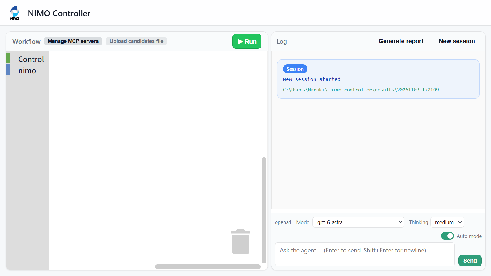
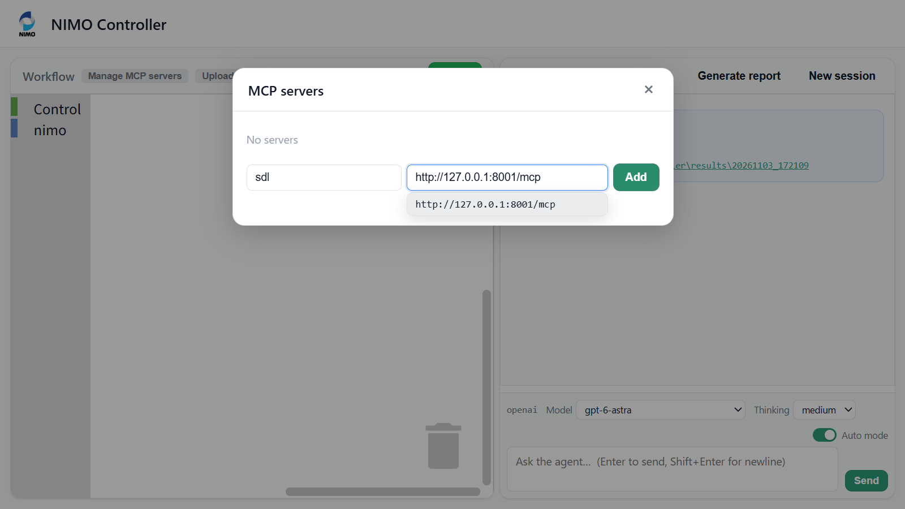
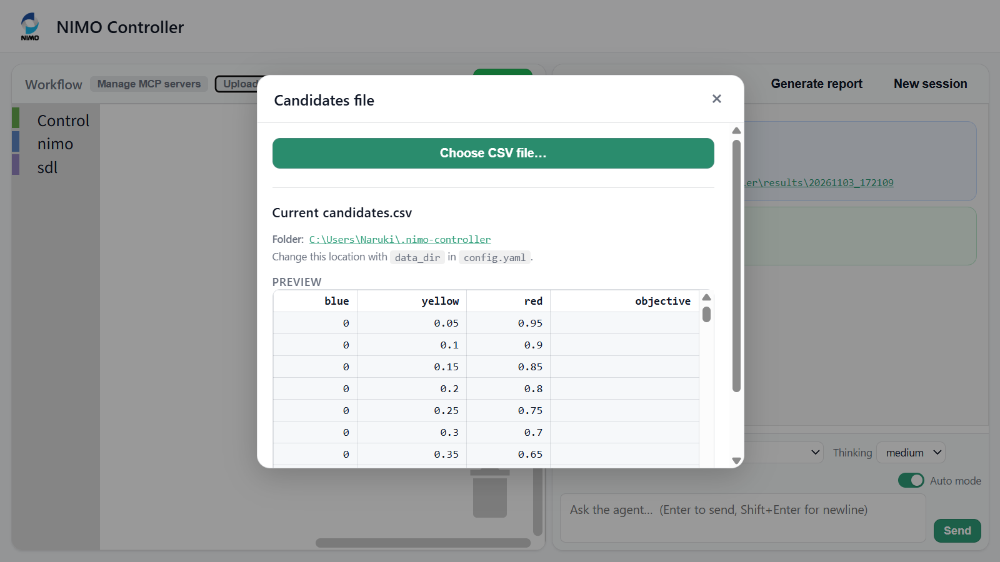
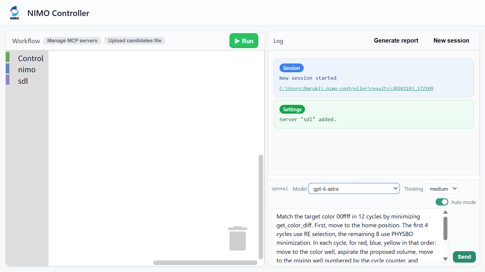
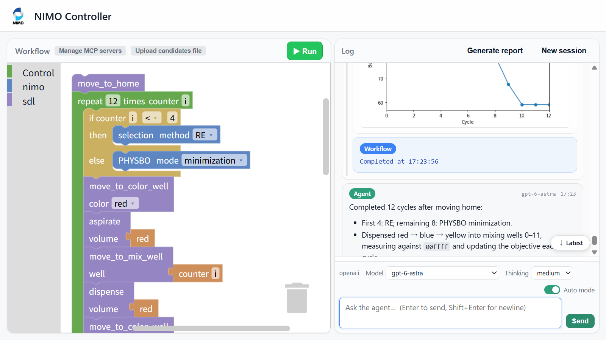

# nimo-controller

## Installation

Using [uv](https://docs.astral.sh/uv/) is recommended for development:

```
git clone https://github.com/NIMS-DA/nimo-controller.git
cd nimo-controller
uv sync
```

## Examples

### Configuration
You need to configure the agent settings to use the agent mode of NIMO Controller.

In this example, we assume you have set your OpenAI API key in the `OPENAI_API_KEY` environment variable.

Open `config.yaml` in an editor and edit it as follows.
See the comments in the file for more information.

```yaml
port: 8888
enable_agent: true
agent:
  provider: openai
```

### Color matching

The `example_mcp/color_matching` directory contains an example MCP server that implements the color-matching SDL example from the paper in a simulated environment.

Start the MCP server:

```
cd example_mcp/color_matching
uv run mcp_color_matching.py
```

In a separate terminal, launch NIMO Controller:

```
cd nimo-controller
uv run nimo-controller
```

Then open `http://127.0.0.1:8888/` in your browser.
You will see an empty screen.



First, you need to add the MCP server.
Click the `Manage MCP servers` button, type `sdl` as the name for the MCP server and `http://127.0.0.1:8001/mcp` as its URL, and press `Add`.
An `sdl` toolbox category will appear in the Blockly interface.



Click the `Upload candidates file` button and upload `example_mcp/color_matching/candidates.csv`.
Once uploaded, the `blue`, `yellow`, and `red` blocks will appear in the NIMO toolbox.



Choose your favorite OpenAI model in the chat box (here we use `gpt-6-astra`) and type the following prompt:

`Match the target color 00ffff in 12 cycles by minimizing get_color_diff. First, move to the home position. The first 4 cycles use RE selection, the remaining 8 use PHYSBO minimization. In each cycle, for red, blue, yellow in that order: move to the color well, aspirate the proposed volume, move to the mixing well numbered by the cycle counter, and dispense it. Then evaluate get_color_diff on that well against 00ffff and update the objective. Finally, plot the best-value history in minimization mode.`



After a while, the agent constructs the workflow and executes it.

